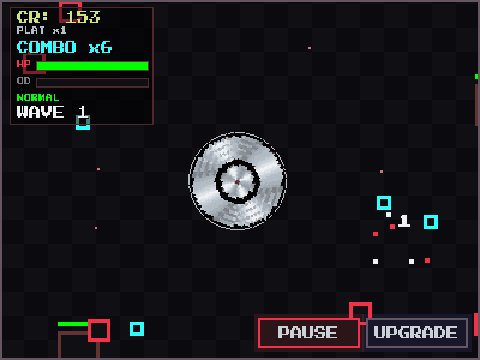

# Beat Barrage

**An idle tower-defence game that plays your music.** Beat Barrage sits in a corner of your screen, always on top of your other windows. It listens to whatever is playing on your computer and turns the bass, mids and highs into attacks.



*Gameplay capture: the turntable core fires on each kick drum as enemies close in.*

## How it works

1. **Capture:** a background thread records the system's audio output (WASAPI loopback via `soundcard`) in 1,024-sample chunks at 44.1 kHz.
2. **Analyze:** each chunk goes through a real-time FFT (`numpy.fft.rfft`) and is split into three frequency bands:

   | Band | Approx. range | Weapon |
   |------|---------------|--------|
   | Bass | ~40–220 Hz | Missiles with explosive area damage |
   | Mids | ~260–1,900 Hz | Lasers (unlocks at level 5) |
   | Highs | ~1.9–6.4 kHz | Chain lightning (unlocks at level 10) |

3. **Detect beats:** each band keeps a rolling average. A beat fires when the current energy jumps 1.6× above it, so the game adapts to quiet and loud songs alike.
4. **Fight:** beats trigger weapons, overall volume drives the background and core spin, and keeping a high combo charges **Overdrive**, a burst mode you trigger with `Space`.

## Features

- Frameless 400×300 window that snaps to any corner of any monitor and stays on top while you work
- 8 permanent upgrades, 20 equippable **charms** with synergies, and roguelike **perks** picked after every wave
- Normal, Hard and Crazy difficulties, plus elite enemies, bosses and a rare ghost
- Leveling, prestige and unlockable turntable skins (Silver, Gold, Neon, Diamond)
- Encrypted save files (Fernet) to discourage save editing
- Steamworks integration: a "Highest Wave" leaderboard and Steam Workshop custom skins
- Packaged as a single Windows `.exe` with PyInstaller

## Tech stack

Python · pygame · NumPy (FFT) · soundcard · cryptography · pywin32 / ctypes (Win32 window management) · SteamworksPy · PyInstaller

## Run it

Windows 10/11 and Python 3.10+:

```bash
pip install -r requirements.txt
python beat_barrage.py
```

Play some music, click **New Game**, pick a difficulty and let it defend itself. Steam features turn on only when the Steamworks DLLs are present; otherwise the game runs without them.

### Build the .exe

```bash
pip install pyinstaller
pyinstaller BeatBarrage.spec
```

The executable is written to `dist/BeatBarrage.exe`.

## Credits

Made by **Roan Malec** ([GitHub](https://github.com/rMalec29) · [LinkedIn](https://www.linkedin.com/in/roan-malec-9726a32bb/)).

The font is [Press Start 2P](https://fonts.google.com/specimen/Press+Start+2P) by CodeMan38, used under the SIL Open Font License (see `FONT-LICENSE-OFL.txt`).
